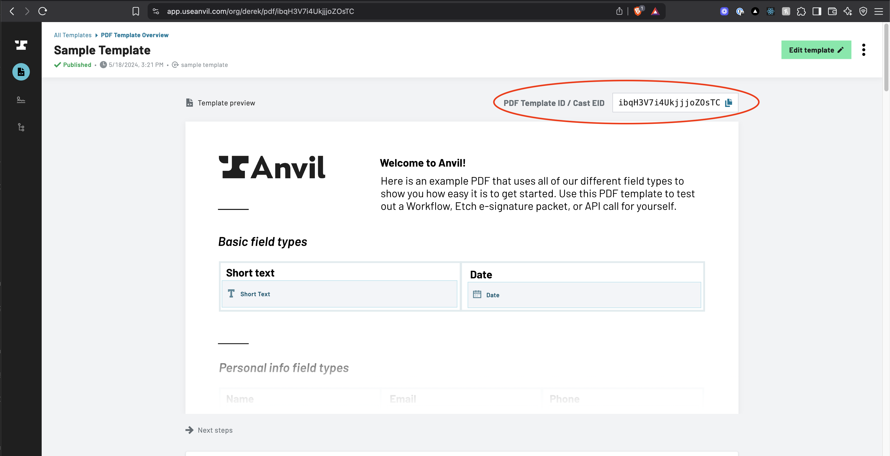

# Anvil API Client for Node

This library will allow you to interact with the [Anvil API](www.useanvil.com/developers) in JavaScript / NodeJS.

[Anvil](https://www.useanvil.com/developers/) provides easy APIs for all things paperwork.

1. [PDF filling API](https://www.useanvil.com/products/pdf-filling-api/) - fill out a PDF template with a web request and structured JSON data.
2. [PDF generation API](https://www.useanvil.com/products/pdf-generation-api/) - send markdown or HTML and Anvil will render it to a PDF.
3. [Etch e-sign with API](https://www.useanvil.com/products/etch/) - customizable, embeddable, e-signature platform with an API to control the signing process end-to-end.
4. [Anvil Workflows (w/ API)](https://www.useanvil.com/products/workflows/) - Webforms + PDF + e-sign with a powerful no-code builder. Easily collect structured data, generate PDFs, and request signatures.

Learn more on our [Anvil developer page](https://www.useanvil.com/developers/). See the [API guide](https://www.useanvil.com/docs) and the [GraphQL reference](https://www.useanvil.com/docs/api/graphql/reference/) for full documentation.

## Usage

This library and the Anvil APIs are intended to be used on a server or server-like environment. It will fail in a browser environment.

Requires Node 20 or later.

```sh
yarn add @anvilco/anvil
```

It works as a CommonJS module or an ES module, in JavaScript or TypeScript:

```js
const Anvil = require('@anvilco/anvil')
// or
import Anvil from '@anvilco/anvil'
```

### TypeScript

The client's types come from [`@anvilco/types`](https://www.npmjs.com/package/@anvilco/types), which is generated from the Anvil API's GraphQL schema and OpenAPI spec and installed with the client. The `variables` of each GraphQL method and the payloads of `fillPDF` and `generatePDF` are typed from them, so a misspelled or missing argument is a compile error. For your own queries, and for the types of what the API returns, use its `GraphQL` namespace:

```ts
import type { GraphQL } from '@anvilco/types'

type Packet = GraphQL.Type<'EtchPacket'>
type PacketArgs = GraphQL.MutationArgs<'createEtchPacket'>
```

The arguments of `createEtchPacket` that the GraphQL schema can only call `JSON` are typed too, and exported by name for building them up separately:

```ts
import type { EtchSigner } from '@anvilco/anvil'

const signer: EtchSigner = {
  id: 'signer1',
  name: 'Sally Signer',
  email: 'sally@example.com',
  signerType: 'embedded',
  fields: [{ fileId: 'lease', fieldId: 'signature1' }],
}
```

If you pass your own `mutation` to a method, its variables may differ from the API's arguments for that mutation; cast them if TypeScript objects.

```sh
npm install @anvilco/anvil
```

A basic example converting your JSON to a filled PDF, then saving the PDF to a file:

```js
import fs from 'fs'
import Anvil from '@anvilco/anvil'

// The ID of the PDF template to fill
const pdfTemplateID = 'kA6Da9CuGqUtc6QiBDRR'
// Your API key from your Anvil organization settings
const apiKey = '7j2JuUWmN4fGjBxsCltWaybHOEy3UEtt'

// JSON data to fill the PDF
const exampleData = {
  "title": "My PDF Title",
  "fontSize": 10,
  "textColor": "#CC0000",
  "data": {
    "someFieldId": "Hello World!"
  }
}
const anvilClient = new Anvil({ apiKey })
const { statusCode, data } = await anvilClient.fillPDF(pdfTemplateID, exampleData)

// By default, if the PDF has been published then the published version is what will
// be filled. If the PDF has not been published, then the most recent version will
// be filled. 
// 
// However, a version number can also be passed in that will be used retrieve and
// fill a specific version of the PDF.
// You can also use the constant `Anvil.VERSION_LATEST` (or `-1`) to fill the most 
// recent version of your PDF, whether that version has been published or not.
// Use this if you'd like to fill out a draft version of your template/PDF.
const options = { versionNumber: Anvil.VERSION_LATEST }
const { statusCode, data } = await anvilClient.fillPDF(pdfTemplateID, exampleData, options)

console.log(statusCode) // => 200

// Data will be the filled PDF raw bytes
fs.writeFileSync('output.pdf', data, { encoding: null })
```

## API

* [Constructor](#new-anviloptions)
* [fillPDF(pdfTemplateID, payload[, options])](#fillpdfpdftemplateid-payload-options)
* [generatePDF(payload[, options])](#generatepdfpayload-options)
* [createEtchPacket(options)](#createetchpacketoptions)
* [getEtchPacket(options)](#getetchpacketoptions)
* [generateEtchSignUrl(options)](#generateetchsignurloptions)
* [downloadDocuments(documentGroupEid[, options])](#downloaddocumentsdocumentgroupeid-options)
* [forgeSubmit(options)](#forgesubmitoptions)
* [removeWeldData(options)](#removewelddataoptions)
* [requestGraphQL(queryInfo[, options])](#requestgraphqlqueryinfo-options)
* [requestREST(url, fetchOptions[, clientOptions])](#requestresturl-fetchoptions-clientoptions)
* [prepareGraphQLFile(pathOrStreamLikeThing[, options])](#preparegraphqlfilepathorstreamlikething-options)
* [Options](#options), including [authentication](#authentication) and [baseURL](#baseurl)
* [Constants](#constants)
* [Errors](#errors)

#### Method names

Every method with an acronym in its name can also be called with the acronym in plain camel case, and vice versa. Use whichever you prefer; they are the same method.

| | |
|---|---|
| `fillPDF` | `fillPdf` |
| `generatePDF` | `generatePdf` |
| `generateEtchSignUrl` | `generateEtchSignURL` |
| `requestGraphQL` | `requestGraphql` or `requestGraphQl` |
| `requestREST` | `requestRest` |
| `prepareGraphQLFile` | `prepareGraphqlFile` or `prepareGraphQlFile` |

The `baseURL` option is also accepted as `baseUrl`.

### Instance Methods

##### new Anvil(options)

Creates an Anvil client instance.

* `options` (Object) - [Options](#options) for the Anvil Client instance.

```js
const anvilClient = new Anvil({ apiKey: 'abc123' })
```
<br />

##### fillPDF(pdfTemplateID, payload[, options])

Fills a PDF template with your JSON data.

First, you will need to have [uploaded a PDF to Anvil](https://useanvil.com/docs/api/fill-pdf#creating-a-pdf-template). You can find the PDF template's ID on PDF template's page:



If you already have the URL to the page in Anvil, the ID is there as well: `https://app.useanvil.com/org/<your-org-slug>/pdf/<pdf-template-id>`

An example:

```js
const fs = require('fs')

// PDF template you uploaded to Anvil
const pdfTemplateID = 'kA6Da9CuGqUtc6QiBDRR'

// Your API key from your Anvil organization settings
const apiKey = '7j2JuUWmN4fGjBxsCltWaybHOEy3UEtt'

// JSON data to fill the PDF
const payload = {
  "title": "My PDF Title",
  "fontSize": 10,
  "textColor": "#CC0000",
  "data": {
    "someFieldId": "Hello World!"
  }
}
// The 'options' parameter is optional
const options = {
  "dataType": "buffer"
}
const anvilClient = new Anvil({ apiKey })
const { statusCode, data } = await anvilClient.fillPDF(pdfTemplateID, payload, options)

// Be sure to write the file as raw bytes
fs.writeFileSync('filled.pdf', data, { encoding: null })
```

* `pdfTemplateID` (String) - The id of your PDF template from the Anvil UI
* `payload` (Object) - The JSON data that will fill the PDF template
  * `title` (String) - _optional_ Set the title encoded into the PDF document
  * `fontSize` (Number) - _optional_ Set the fontSize of all filled text. Default is 10.
  * `color` (String) - _optional_ Set the text color of all filled text. Default is dark blue.
  * `data` (Object) - The data to fill the PDF. The keys in this object will correspond to a field's ID in the PDF. These field IDs and their types are available on the PDF template's page in the Anvil dashboard.
    * For example `{ "someFieldId": "Hello World!" }`
* `options` (Object) - _optional_ Any additional options for the request
  * `dataType` (Enum[String]) - _optional_ Set the type of the `data` value that is returned in the resolved `Promise`. Defaults to `'buffer'`, but `'arrayBuffer'` and `'stream'` are also supported.
  * `versionNumber` (Number) - _optional_ The version of the PDF template to fill. Defaults to the latest published version, or the latest version if the template has never been published. See [Constants](#constants).
  * `throwOnError` (Boolean) - _optional_ Overrides the client's [`throwOnError`](#throwonerror) for this request.
* Returns a `Promise` that resolves to an `Object`
  * `statusCode` (Number) - the HTTP status code; `200` is success
  * `data` (Buffer | ArrayBuffer | Stream) - The raw binary data of the filled PDF if success. Will be either a Buffer, ArrayBuffer, or a Stream, depending on `dataType` option supplied to the request.
  * `errors` (Array of Objects) - Will be present if status >= 400. See Errors
    * `message` (String)

##### generatePDF(payload[, options])

Dynamically generate a new PDF from your HTML and CSS or markdown.

Useful for agreements, invoices, disclosures, or any other text-heavy documents. This does not require you do anything in the Anvil UI other than setup your API key, just send it data, get a PDF. See [the generate PDF docs](https://useanvil.com/api/generate-pdf) for full details.

* [HTML to PDF docs](https://www.useanvil.com/docs/api/generate-pdf#html--css-to-pdf)
* [Markdown to PDF docs](https://www.useanvil.com/docs/api/generate-pdf#markdown-to-pdf)

Check out our [HTML invoice template](https://github.com/anvilco/html-pdf-invoice-template) for a complete HTML to PDF example.

An example:

```js
const fs = require('fs')

// Your API key from your Anvil organization settings
const apiKey = '7j2JuUWmN4fGjBxsCltWaybHOEy3UEtt'

// An example using an HTML to PDF payload
const payload = {
  title: 'Example',
  type: 'html',
  data: {
    html: `
      <h1 class='header-one'>What is Lorem Ipsum?</h1>
      <p>
        Lorem Ipsum is simply dummy text...
      </p>
      <h3 class='header-two'>Where does it come from?</h3>
      <p>
        Contrary to popular belief, Lorem Ipsum is not simply <i>random text</i>
      </p>
    `,
    css: `
      body { font-size: 14px; color: #171717; }
      .header-one { text-decoration: underline; }
      .header-two { font-style: underline; }
    `,
  },
}

// An example using a Markdown payload
const payload = {
  title: 'Example Invoice',
  data: [{
    label: 'Name',
    content: 'Sally Jones',
  }, {
    content: 'Lorem **ipsum** dolor sit _amet_',
  }, {
    table: {
      firstRowHeaders: true,
      rows: [
        ['Description', 'Quantity', 'Price'],
        ['4x Large Widgets', '4', '$40.00'],
        ['10x Medium Sized Widgets in dark blue', '10', '$100.00'],
        ['10x Small Widgets in white', '6', '$60.00'],
      ],
    },
  }],
}
// The 'options' parameter is optional
const options = {
  "dataType": "buffer"
}
const anvilClient = new Anvil({ apiKey })
const { statusCode, data } = await anvilClient.generatePDF(payload, options)

// Be sure to write the file as raw bytes
fs.writeFileSync('generated.pdf', data, { encoding: null })
```

* `payload` (Object) - The JSON data that will fill the PDF template
  * `title` (String) - _optional_ Set the title encoded into the PDF document
  * `data` (Array of Objects) - The data that generates the PDF. See [the docs](https://useanvil.com/docs/api/generate-pdf#supported-format-of-data) for all supported objects
    * For example `[{ "label": "Hello World!", "content": "Test" }]`
* `options` (Object) - _optional_ Any additional options for the request
  * `dataType` (Enum[String]) - _optional_ Set the type of the `data` value that is returned in the resolved `Promise`. Defaults to `'buffer'`, but `'arrayBuffer'` and `'stream'` are also supported.
  * `throwOnError` (Boolean) - _optional_ Overrides the client's [`throwOnError`](#throwonerror) for this request.
* Returns a `Promise` that resolves to an `Object`
  * `statusCode` (Number) - the HTTP status code; `200` is success
  * `data` (Buffer | ArrayBuffer | Stream) - The raw binary data of the filled PDF if success. Will be either a Buffer, ArrayBuffer, or a Stream, depending on `dataType` option supplied to the request.
  * `errors` (Array of Objects) - Will be present if status >= 400. See Errors
    * `message` (String)

##### createEtchPacket(options)

Creates an Etch Packet and optionally sends it to the first signer.

```js
const anvilClient = new Anvil({ apiKey })

const { statusCode, data, errors } = await anvilClient.createEtchPacket({
  variables: {
    name: 'Example packet',
    // Test packets use development signatures and are not billed
    isTest: true,
    // Send it to the first signer right away
    isDraft: false,
    files: [{
      id: 'uploadedNDA',
      title: 'Demo NDA',
      file: Anvil.prepareGraphQLFile('./nda.pdf'),
      fields: [{
        id: 'signatureOne',
        type: 'signature',
        pageNum: 0,
        rect: { x: 100, y: 100, width: 150, height: 30 },
      }],
    }],
    signers: [{
      id: 'signerOne',
      name: 'Sally Signer',
      email: 'sally@example.com',
      // 'embedded' signers sign in your app with a URL from generateEtchSignUrl.
      // The default, 'email', sends them an email.
      signerType: 'embedded',
      fields: [{ fileId: 'uploadedNDA', fieldId: 'signatureOne' }],
    }],
  },
})

const etchPacket = data.data.createEtchPacket
const signerEid = etchPacket.documentGroup.signers[0].eid
```

* `options` (Object) - An object with the following structure:
  * `variables` (Object) - See the [API Documentation](#api-documentation) area for details. See [Examples](#examples) area for examples.
  * `responseQuery` (String) - _optional_ A GraphQL Query compliant query to use for the data desired in the mutation response. Can be left out to use default.
  * `mutation` (String) - _optional_ If you'd like complete control of the GraphQL mutation, you can pass in a GraphQL Mutation compliant string that will be used in the mutation call. This string should also include your response query, as the `responseQuery` param is ignored if `mutation` is passed. Example:
    ```graphql
      mutation CreateEtchPacket (
        $name: String,
        ...
      ) {
        createEtchPacket (
          name: $name,
          ...
        ) {
          id
          eid
          ...
        }
      }
    ```

##### getEtchPacket(options)

Gets the details of an Etch Packet.

```js
const { statusCode, data, errors } = await anvilClient.getEtchPacket({
  variables: { eid: etchPacketEid },
})
const { status, documentGroup } = data.data.etchPacket
```

* `options` (Object) - An object with the following structure:
  * `variables` (Object) - Requires `eid`
    * `eid` (String) - your Etch Packet eid
  * `responseQuery` (String) - _optional_ A GraphQL Query compliant query to use for the data desired in the query response. Can be left out to use default.

##### generateEtchSignUrl(options)

Generates an Etch sign URL for an Etch Packet signer. The Etch Packet and its signers must have already been created, the packet must have been sent, and the signer must be an `embedded` signer.

```js
const { statusCode, url, errors } = await anvilClient.generateEtchSignUrl({
  variables: {
    signerEid,
    // Your ID for the user who will be signing
    clientUserId: 'user-123',
  },
})
// Send your user to `url` to sign
```

* `options` (Object) - An object with the following structure:
  * `variables` (Object) - Requires `clientUserId` and `signerEid`
    * `clientUserId` (String) - your ID for the user who will sign
    * `signerEid` (String) - the eid of the Etch Packet signer, found in the response of the `createEtchPacket` instance method
* Returns a `Promise` that resolves to an `Object`
  * `statusCode` (Number) - the HTTP status code; `200` is success
  * `url` (String) - the signing URL
  * `errors` (Array of Objects) - Will be present if there was a problem. See [Errors](#errors)

##### downloadDocuments(documentGroupEid[, options])

Returns a Buffer, ArrayBuffer, or Stream of the document group specified by the documentGroupEid in Zip file format.

```js
const { statusCode, data, errors } = await anvilClient.downloadDocuments(documentGroupEid)
fs.writeFileSync('documents.zip', data, { encoding: null })

// Or stream it
const { data: stream } = await anvilClient.downloadDocuments(documentGroupEid, { dataType: 'stream' })
stream.pipe(fs.createWriteStream('documents.zip'))
```

* `documentGroupEid` (string) - the eid of the document group to download
* `options` (Object) - _optional_ Any additional options for the request
  * `dataType` (Enum[String]) - _optional_ Set the type of the `data` value that is returned in the resolved `Promise`. Defaults to `'buffer'`, but `'arrayBuffer'` and `'stream'` are also supported.
  * `throwOnError` (Boolean) - _optional_ Overrides the client's [`throwOnError`](#throwonerror) for this request.
* Returns a `Promise` that resolves to an `Object`
   * `statusCode` (Number) - the HTTP status code, `200` is success
   * `response` (Object) - the Response object resulting from the client's request to the Anvil app
   * `data` (Buffer | ArrayBuffer | Stream) - The raw binary data of the downloaded documents if success. Will be in the format of either a Buffer, ArrayBuffer, or a Stream, depending on `dataType` option supplied to the request.
   * `errors` (Array of Objects) - Will be present if status >= 400. See Errors
      * `message` (String)

##### forgeSubmit(options)

Creates or updates a submission to a webform in a Workflow, the same as someone filling in and submitting that webform. Webforms are called Forges in the API.

```js
const { statusCode, data, errors } = await anvilClient.forgeSubmit({
  variables: {
    // The webform's eid
    forgeEid: 'your-forge-eid',
    // Keys are the IDs of the webform's fields
    payload: {
      name: 'Sally Jones',
      email: 'sally@example.com',
    },
    isTest: true,
  },
})
const submission = data.data.forgeSubmit
const weldDataEid = submission.weldData.eid
```

* `options` (Object) - An object with the following structure:
  * `variables` (Object) - Requires `forgeEid` and `payload`. Pass `weldDataEid` and `submissionEid` to update an existing submission. See the [GraphQL reference](https://www.useanvil.com/docs/api/graphql/reference/) for all variables.
  * `responseQuery` (String) - _optional_ A GraphQL Query compliant query to use for the data desired in the mutation response. Can be left out to use default.
  * `mutation` (String) - _optional_ Your own complete GraphQL mutation. `responseQuery` is ignored if this is passed.
* Returns a `Promise` that resolves to an `Object` with `statusCode`, `data` and `errors`, like [requestGraphQL](#requestgraphqlqueryinfo-options)

##### removeWeldData(options)

Deletes a Workflow submission (a `WeldData`) and everything in it.

```js
const { statusCode, data, errors } = await anvilClient.removeWeldData({
  variables: { eid: weldDataEid },
})
const removed = data.data.removeWeldData // true
```

* `options` (Object) - An object with the following structure:
  * `variables` (Object) - Requires `eid`
    * `eid` (String) - the eid of the WeldData to remove
  * `mutation` (String) - _optional_ Your own complete GraphQL mutation.
* Returns a `Promise` that resolves to an `Object` with `statusCode`, `data` and `errors`, like [requestGraphQL](#requestgraphqlqueryinfo-options)

##### requestGraphQL(queryInfo[, options])

A fallback function for queries and mutations without a specialized function in this client.

See the [GraphQL reference](https://www.useanvil.com/docs/api/graphql/reference/) for a listing on all possible queries

```js
const result = await client.requestGraphQL({
  query: `
    query WeldDataQuery ($eid: String!) {
      weldData (eid: $eid) {
        eid
        isComplete
        isTest
      }
    }
  `,
  variables: { eid: 'nxflNZqxDUbltLUbYWK' },
})
const { statusCode, data, errors } = result

if (errors) {
  // GraphQL errors (with a 200 statusCode) or HTTP errors. See Errors.
} else {
  const weldData = data.data.weldData
}
```

* `queryInfo` (Object)
  * `query` (String) - GraphQL query or mutation to run. See the [GraphQL reference](https://www.useanvil.com/docs/api/graphql/reference/) for a listing on all possible queries
  * `variables` (Object) - GraphQL variables for the query. Files to upload can be anywhere in here; see [prepareGraphQLFile](#preparegraphqlfilepathorstreamlikething-options).
* `options` (Object) - _optional_ Any additional options for the request
  * `throwOnError` (Boolean) - _optional_ Overrides the client's [`throwOnError`](#throwonerror) for this request.
* Returns a `Promise` that resolves to an `Object`
  * `statusCode` (Number) - The HTTP status code. GraphQL errors come back with a `200`; you will only see other codes if the request itself was a problem, e.g. it was malformed or unauthorized.
  * `data` (Object) - Present when there are no errors
    * `data` (Object) - Contains the actual result of the query
      * `[queryName]` (Object) - Use the query or mutation name to reference the data that you requested!
  * `errors` (Array of Objects) - Present when there were GraphQL or HTTP errors. See [Errors](#errors)

##### requestREST(url, fetchOptions[, clientOptions])

A fallback function for REST endpoints without a specialized function in this client.

See the [GraphQL reference](https://www.useanvil.com/docs/api/graphql/reference/) for a listing on all possible queries

```js
const result = await this.requestREST(
  `/api/v1/fill/${pdfTemplateID}.pdf`,
  {
    method: 'POST',
    body: JSON.stringify(payload),
    headers: {
      'Content-Type': 'application/json',
    },
  },
  {
    dataType: 'stream',
  },
)
```

* `url` (String) - URL from the baseURL. e.g. `/api/v1/fill`
* `fetchOptions` (Object) - Options passed to [fetch](https://undici.nodejs.org/#/docs/api/Fetch). The client uses [undici](https://github.com/nodejs/undici)'s `fetch`.
* `clientOptions` (Object) - _optional_ Any additional options for the request
  * `dataType` (Enum[String]) - _optional_ Set the type of the `data` value that is returned in the resolved `Promise`. Defaults to `'buffer'`, `'arrayBuffer'`, `'stream'`, and `'json'` are also supported.
  * `throwOnError` (Boolean) - _optional_ Overrides the client's [`throwOnError`](#throwonerror) for this request.
* Returns a `Promise` that resolves to an `Object`
  * `statusCode` (Number) - the HTTP status code; `200` is success
  * `data` (Buffer | ArrayBuffer | Stream) - The raw binary data of the filled PDF if success. Will be either a Buffer, ArrayBuffer, or a Stream, depending on `dataType` option supplied to the request.
  * `errors` (Array of Objects) - Will be present if status >= 400. See Errors
    * `message` (String)

### Class Methods

* [prepareGraphQLFile(pathOrStreamLikeThing[, options])](#preparegraphqlfilepathorstreamlikething-options)

##### prepareGraphQLFile(pathOrStreamLikeThing[, options])

A nice helper to prepare a [File](https://developer.mozilla.org/en-US/docs/Web/API/File) upload for use with our GraphQL API. By default, this will upload your files as multipart uploads over the [jaydenseric / GraphQL multipart request spec](https://github.com/jaydenseric/graphql-multipart-request-spec). Files given as a path or a stream are streamed to the API rather than read into memory first. If a request has to be retried (see [Rate Limits](#rate-limits)), files given as a path, a file stream or a `Buffer` are sent again; any other stream can only be read once, so the retry fails with an error instead. NOTE: Please see below about certain scenarios where you may need to manually provide a `filename`.

* `pathOrSupportedInstance` (String | File | Blob | Stream | Buffer) - Can be one of several things. Here's a list of what's supported, in order of preference:
  1. A `File` instance.
  1. A `Blob` instance.
  1. A `string` that is a path to a file to be used.
  1. A `ReadStream` instance that must either have either:
     1. A `path` property (this will usually be present when the stream was loaded from the local file system)
     1. A `filename` provided in the `options` parameter.
  1. A `Buffer` instance with a `filename` provided in the `options` parameter.
* `options` (Object) - Options that may be required when providing certain types of values as the first parameter. For example, `Blob`s, `Buffer`s and certain kinds of `ReadStream`s will not have any notion of what the name of the file is or should be when uploaded.
  * `filename` (String) - Override the filename of the uploaded file here. If providing a generic ReadStream or Buffer, you will be required to provide a filename here
  * `mimetype` (String) - Optional mimetype to specify with the resulting file that can be used when a `string` path, `Buffer` or `ReadStream` are provided as the first parameter.
* Returns an `Object` that is properly formatted to be coerced by the client for use against our GraphQL API wherever an `Upload` type is required.

### Options

Options for the Anvil Client. Defaults are shown after each option key.

```js
{
  // One of apiKey or accessToken is required. See Authentication.
  apiKey: <your_api_key>,
  accessToken: <oauth_access_token>,

  // Where to send requests. See baseURL. Also accepted as baseUrl.
  baseURL: 'https://app.useanvil.com',

  // Sent as the User-Agent header
  userAgent: 'Anvil API Client/<version>',

  // How many requests to allow per requestLimitMS until the first response from
  // the API tells the client your actual limits. See Rate Limits.
  requestLimit: 1,
  requestLimitMS: 1000,

  // An undici Dispatcher to send requests with, e.g. to use a proxy:
  // new ProxyAgent('http://proxy.example.com:8080'). Defaults to the client's own Agent.
  dispatcher: <undici_dispatcher>,

  // Reject with an AnvilRequestError when the API responds with an error, rather
  // than resolve with `errors`. See throwOnError.
  throwOnError: false,
}
```

##### Authentication

Authenticate with either an API key or an OAuth access token.

**API key:** Find your API keys in your Anvil organization's settings. Requests use HTTP Basic auth: `Basic base64(apiKey + ':')`.

```js
const anvilClient = new Anvil({ apiKey: 'your-api-key' })
```

**OAuth access token:** Requests use Bearer auth. Anvil's access tokens are JWTs, which are sent as-is: `Bearer <accessToken>`. Any other kind of token is base64 encoded: `Bearer base64(accessToken)`.

```js
const anvilClient = new Anvil({ accessToken: 'your-oauth-access-token' })
```

If you pass both, the `accessToken` is used.

##### baseURL

By default, requests go to production, `https://app.useanvil.com`. Set `baseURL` to send them somewhere else. All requests go to that host:

* REST: `{baseURL}/api/v1/...`
* GraphQL: `{baseURL}/graphql`
* Document downloads: `{baseURL}/api/document-group/{eid}.zip`

```js
const anvilClient = new Anvil({
  apiKey: 'your-api-key',
  baseURL: 'https://anvil.example.com',
})
```

Don't include a trailing slash.

### Constants

* `Anvil.VERSION_LATEST` (`-1`) - With `fillPDF`'s `versionNumber` option, fills the most recent version of a PDF template, published or not. Use it to fill drafts.
* `Anvil.VERSION_LATEST_PUBLISHED` (`-2`) - Fills the latest published version. Unlike leaving `versionNumber` out, this returns an error if the template has never been published.

### Errors

By default, the client's methods don't reject because of a problem response from the API. Instead, they resolve with an `errors` array alongside the `statusCode`. Each item has a `message`, a `name`, or both. To have them reject instead, turn on [`throwOnError`](#throwonerror).

```js
const { statusCode, data, errors } = await anvilClient.fillPDF(pdfTemplateID, payload)
if (errors) {
  console.log(statusCode, errors)
}
```

`errors` looks like one of these:

* **GraphQL errors**, as returned by the API, often with a `200` `statusCode`:
  ```js
  [{ message: 'Not Found', path: ['etchPacket'], locations: [{ line: 2, column: 3 }] }]
  ```
* **A REST error.** Validation errors have no `message`, but list each problem field:
  ```js
  [{ name: 'AssertionError', message: 'PDF did not generate properly from given HTML!' }]
  [{ name: 'ValidationError', status: 400, fields: [{ message: 'Required', property: 'data' }] }]
  ```
* **A response that isn't JSON**, like a `502` from a proxy. The `name` and `message` are the HTTP status text:
  ```js
  [{ name: 'Bad Gateway', message: 'Bad Gateway' }]
  ```
* **A JSON response that couldn't be parsed.** This is the parsing error's `name`, `message`, `code`, `cause` and `stack`:
  ```js
  [{ name: 'SyntaxError', message: 'Unexpected end of JSON input', stack: '...' }]
  ```

The methods do reject when a request can't be made at all, e.g. because of a network error. These are `fetch` errors, with details in `cause`:

```js
try {
  await anvilClient.fillPDF(pdfTemplateID, payload)
} catch (error) {
  console.log(error.message) // 'fetch failed'
  console.log(error.cause.code) // e.g. 'ECONNREFUSED'
}
```

If the connection closes before the whole response arrives, a method that returns binary data (like `fillPDF` or `downloadDocuments`) rejects with `TypeError: terminated`. One that returns JSON resolves with `errors: [{ name: 'TypeError', message: 'terminated' }]`.

They also throw for invalid arguments, like an unsupported `dataType`.

##### throwOnError

Pass `throwOnError: true` and the methods reject with an `AnvilRequestError` whenever they would otherwise resolve with `errors`. That way one `try`/`catch` handles every kind of failure. It's off by default; with it off, the methods behave as described above.

```js
const Anvil = require('@anvilco/anvil')
const { AnvilRequestError } = Anvil
// Or: import Anvil, { AnvilRequestError } from '@anvilco/anvil'

const anvilClient = new Anvil({ apiKey, throwOnError: true })

try {
  const { data } = await anvilClient.fillPDF(pdfTemplateID, payload)
  fs.writeFileSync('filled.pdf', data, { encoding: null })
} catch (error) {
  if (error instanceof AnvilRequestError) {
    console.log(error.message) // e.g. '400: ValidationError (data: Required)'
    console.log(error.statusCode, error.errors)
  } else {
    throw error // e.g. 'fetch failed'
  }
}
```

A successful request resolves just as it does with `throwOnError` off.

`fillPDF`, `generatePDF`, `downloadDocuments`, `requestGraphQL` and `requestREST` also accept `throwOnError` in their options, to override the client's setting for one request:

```js
const { statusCode, errors } = await anvilClient.fillPDF(pdfTemplateID, payload, { throwOnError: false })
```

An `AnvilRequestError` has:

* `name` (String) - `'AnvilRequestError'`
* `message` (String) - The status code, then each error's `name` and `message`, and a validation error's fields, separated by `'; '`. For example, `'400: ValidationError (data: Required)'` or `'200: Not Found; Forbidden'`.
* `statusCode` (Number) - The HTTP status code. GraphQL errors usually come with a `200`.
* `errors` (Array of Objects) - The `errors` the method would have resolved with. See above.
* `data` (Object) - Any data the API returned alongside the errors, otherwise `undefined`. A GraphQL request can partly succeed; this is the GraphQL response's `data`, so a query's result is at `error.data.etchPacket`, not `data.data.etchPacket` as when a request succeeds.
* `response` (Response) - The fetch `Response`, e.g. for the [rate limit](#rate-limits) headers.

Everything that rejects with `throwOnError` off still rejects the same way with it on: network errors, a binary response cut short (`TypeError: terminated`), and invalid arguments. A JSON response cut short, which would resolve with `errors: [{ name: 'TypeError', message: 'terminated' }]`, rejects with an `AnvilRequestError`. A `429` is still retried, not thrown.

### Rate Limits

Our API has request rate limits in place. The initial request made by this client will parse the limits for your account from the `X-RateLimit-Limit` and `X-RateLimit-Interval-Ms` response headers, and then handle the throttling of subsequent requests for you automatically. Any requests made while waiting for that first response will wait for it before being sent.

Like the API, the client counts requests over a sliding window: it only holds a request back when `X-RateLimit-Limit` requests have already been sent in the last `X-RateLimit-Interval-Ms`.

In the event that this client still receives a `429 Too Many Requests` error response, it will wait for the number of seconds in the `Retry-After` header, plus 50ms, then retry the request.

See the [Anvil API docs](https://www.useanvil.com/docs/api/getting-started/#rate-limits) for more information on the specifics of the rate limits.

## API Documentation

Our general API Documentation can be found [here](https://www.useanvil.com/api/). It's the best resource for up-to-date information about our API and its capabilities.

See the [PDF filling API docs](https://useanvil.com/docs/api/fill-pdf) for more information about the `fillPDF` method.

## Examples

The [examples](https://github.com/anvilco/node-anvil/tree/main/examples) folder has complete, runnable examples in JavaScript and TypeScript: filling a PDF, generating a PDF from Markdown or HTML, e-signing with a template or an uploaded PDF, and embedded signing with a download of the signed documents.

## Development

See [CONTRIBUTING.md](CONTRIBUTING.md) for how to run the tests and publish a release.
